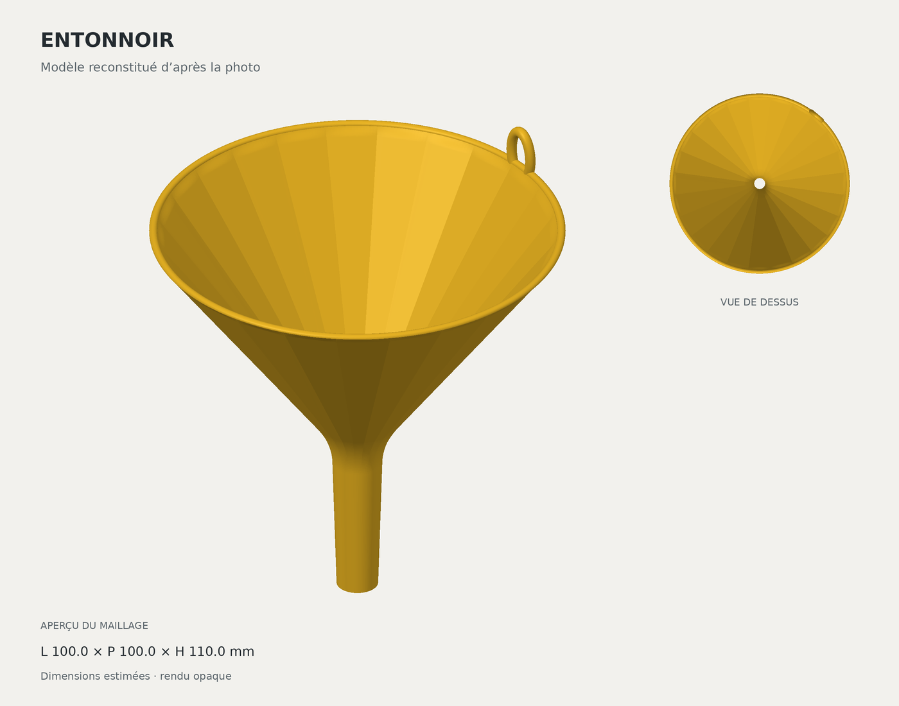

# Entonnoir jaune avec anneau

Modèle creux reconstitué à partir de la photo fournie : cône facetté, raccord arrondi vers un bec fin, sortie ouverte et anneau d'accroche près du bord arrière.



## Fichiers

| Fichier | Contenu |
| --- | --- |
| [entonnoir.stl](exports/entonnoir.stl) | Entonnoir complet en un seul solide, avec anneau intégré et conduit traversant. |
| [entonnoir.3mf](exports/entonnoir.3mf) | Même géométrie avec une couleur jaune et des unités explicites en millimètres. |
| [validation.json](exports/validation.json) | Dimensions et résultats des contrôles géométriques. |

Les exports sont prêts à ouvrir dans un logiciel de tranchage. Le 3MF contient le modèle et sa couleur, sans G-code ni profil d'imprimante. Choisir l'imprimante, le filament et les réglages avant de lancer une impression.

## Dimensions estimées

**La photo ne fournit aucune mesure : ces cotes sont des choix de conception, pas les dimensions vérifiées de l'objet photographié.**

| Paramètre | Valeur retenue |
| --- | ---: |
| Diamètre extérieur de la grande ouverture | 100 mm |
| Hauteur du corps, sans dépassement de l'anneau | 100 mm |
| Hauteur totale avec l'anneau | 110 mm |
| Longueur du bec et de sa partie étroite | Environ 34 mm |
| Diamètre extérieur en sortie | 10 mm |
| Diamètre intérieur en sortie | 6 mm |
| Facettes du cône | 24 |
| Dimensions extérieures de l'anneau | 10 × 15 mm |
| Diamètre de la section de l'anneau | 2,5 mm |
| Décalage radial de paroi | 2 mm |

Les dimensions totales avec l'anneau et les paramètres détaillés figurent dans [src/parameters.json](src/parameters.json) et [exports/validation.json](exports/validation.json). Les épaisseurs radiales du profil ne doivent pas être confondues avec l'épaisseur mesurée perpendiculairement à la paroi inclinée.

## Orientation et tranchage

L'extrémité plane du bec repose sur `Z = 0`, avec la grande ouverture vers le haut. Sa surface d'appui est petite : prévoir une bordure d'adhérence adaptée et examiner les supports éventuels de l'anneau dans le logiciel de tranchage.

L'anneau dépasse le bord de la grande ouverture ; le modèle retourné ne se pose donc pas simplement sur ce bord. Vérifier les couches de la sortie, du raccord entre bec et cône et de l'anneau avant impression.

## Sources modifiables

Les sources sont autonomes et ne nécessitent pas la photo. Depuis la racine du dépôt :

```bash
python -m venv .venv
source .venv/bin/activate
python -m pip install -r models/entonnoir-jaune/src/requirements.txt
python models/entonnoir-jaune/src/generate.py
python models/entonnoir-jaune/src/render_preview.py
```

Sous Windows, activer l'environnement avec `.venv\Scripts\activate`.

- [src/parameters.json](src/parameters.json) : dimensions et paramètres de forme.
- [src/generate.py](src/generate.py) : construction du solide et export des fichiers.
- [src/render_preview.py](src/render_preview.py) : aperçu calculé à partir du STL exporté, sans image de synthèse générative.
- [references/README.md](references/README.md) : origine et limites de la référence photographique.

Après modification des paramètres, relancer le générateur puis le script d'aperçu.

## Vérifications

Les contrôles portent sur le STL réellement enregistré : fermeture du volume de matière, orientation des faces, volume positif et unicité du solide. Un contrôle distinct vérifie le passage axial pour ne pas confondre une coque fermée avec un conduit bouché.

Les résultats sont enregistrés dans [exports/validation.json](exports/validation.json). L'anneau fait partie du même solide que le cône. Aucun essai d'impression physique n'a été réalisé.
