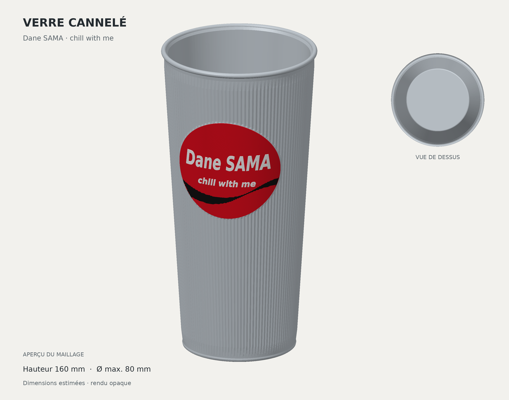

# Verre Dane SAMA cannelé

Verre creux avec fines cannelures verticales, rebord arrondi, fond fermé et médaillon courbe. Le médaillon porte **« Dane SAMA »** et **« chill with me »** en relief blanc, sur fond rouge avec une vague noire. La silhouette reprend le modèle initial reconstitué à partir de la photo fournie ; les inscriptions sont personnalisées.



## Fichiers d'impression

| Fichier | Usage |
| --- | --- |
| [verre.stl](exports/verre.stl) | Verre, médaillon et inscriptions réunis en un seul solide ; impression monochrome. |
| [verre-multicolore.3mf](exports/verre-multicolore.3mf) | Assemblage de quatre volumes colorés : corps, médaillon rouge, inscriptions blanches, vague noire. |
| [verre-sans-logo.stl](exports/verre-sans-logo.stl) | Même verre cannelé, sans médaillon ni inscription. |
| [parts/](exports/parts/) | Les quatre volumes séparés, à importer ensemble en conservant leur position relative. |

Le 3MF contient la géométrie et les couleurs, sans G-code ni profil d'imprimante. Ouvrir le modèle en millimètres dans le logiciel de tranchage, choisir l'imprimante et le matériau, puis attribuer les filaments aux quatre volumes pour l'impression multicolore.

Le fond est placé sur `Z = 0`, avec l'ouverture vers le haut. Vérifier le tranchage du médaillon et des petits caractères avant impression.

## Dimensions retenues

**Dimensions estimées : aucune cote physique n'a été fournie.**

| Paramètre | Valeur à l'échelle 1 |
| --- | ---: |
| Hauteur totale | 160 mm |
| Diamètre maximal au rebord | 80 mm |
| Diamètre du pied | Environ 58,4 mm |
| Épaisseur nominale des parois | 2 mm |
| Épaisseur du fond | 3 mm |
| Nombre de cannelures | 120 |
| Relief des cannelures | 0,32 mm |
| Diamètre apparent du médaillon | 52,6 mm |
| Hauteur du centre du médaillon | 106 mm |
| Relief des lettres par rapport au fond rouge | 0,4 mm |

Le médaillon et les inscriptions épousent la courbure du verre. Les détails invisibles sur la photo, dont l'intérieur et le dessous, ont été reconstitués par hypothèse. Il s'agit d'un modèle décoratif en plastique ; la transparence et l'aptitude au contact alimentaire ne sont pas établies par ces fichiers.

## Sources et régénération

Les sources sont autonomes : la photo de référence n'est pas nécessaire pour générer les fichiers.

Depuis la racine du dépôt :

```bash
python -m venv .venv
source .venv/bin/activate
python -m pip install -r models/verre-dane-sama/src/requirements.txt
python models/verre-dane-sama/src/generate.py
python models/verre-dane-sama/src/render_preview.py
```

Sous Windows, remplacer l'activation par `.venv\Scripts\activate`.

- [src/parameters.json](src/parameters.json) contient les paramètres du verre. `scale` applique une mise à l'échelle uniforme ; `1.125` donne une hauteur de 180 mm et augmente aussi le diamètre, les épaisseurs et le médaillon.
- [src/generate.py](src/generate.py) construit le verre et exporte les STL, le 3MF et le rapport de validation.
- [src/logo-contours.json](src/logo-contours.json) contient les contours vectoriels personnalisés utilisés par le générateur.
- [src/lettering.json](src/lettering.json) contient les textes, leurs dimensions, leur position et la vague décorative.
- [src/generate_text.py](src/generate_text.py) régénère les contours des inscriptions et [leur aperçu vectoriel](previews/lettrage.svg). Les polices utilisées sont fournies avec Matplotlib.
- [src/render_preview.py](src/render_preview.py) produit un aperçu à partir des quatre STL réellement exportés.

Pour régénérer les inscriptions avant le modèle :

```bash
python models/verre-dane-sama/src/generate_text.py
python models/verre-dane-sama/src/generate.py
python models/verre-dane-sama/src/render_preview.py
```

Pour générer uniquement le verre sans médaillon :

```bash
python models/verre-dane-sama/src/generate.py --body-only
```

## Vérifications effectuées

Le générateur recharge les fichiers STL écrits sur disque et vérifie la fermeture du maillage, l'orientation des faces et le volume positif. Les deux STL complets doivent chacun former un seul solide. Les quatre volumes du 3MF sont contrôlés ; leur volume total est comparé à celui du STL assemblé.

Les résultats figurent dans [exports/validation.json](exports/validation.json). L'aperçu montre la géométrie exportée. Aucun essai d'impression physique n'a été réalisé.
